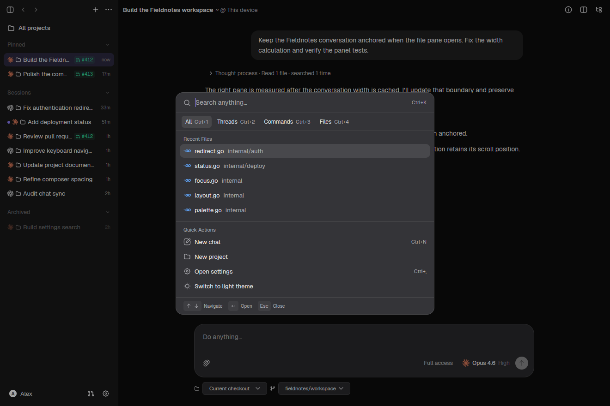
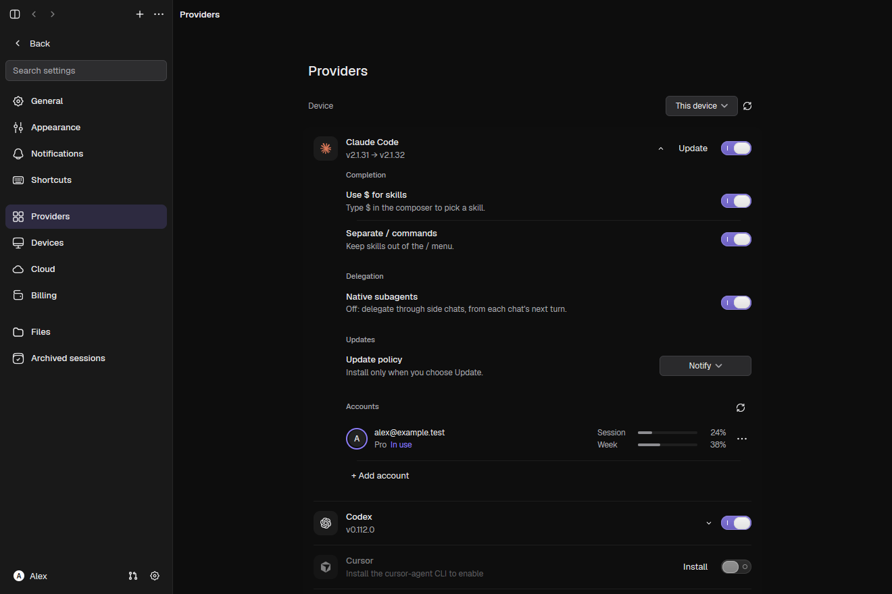
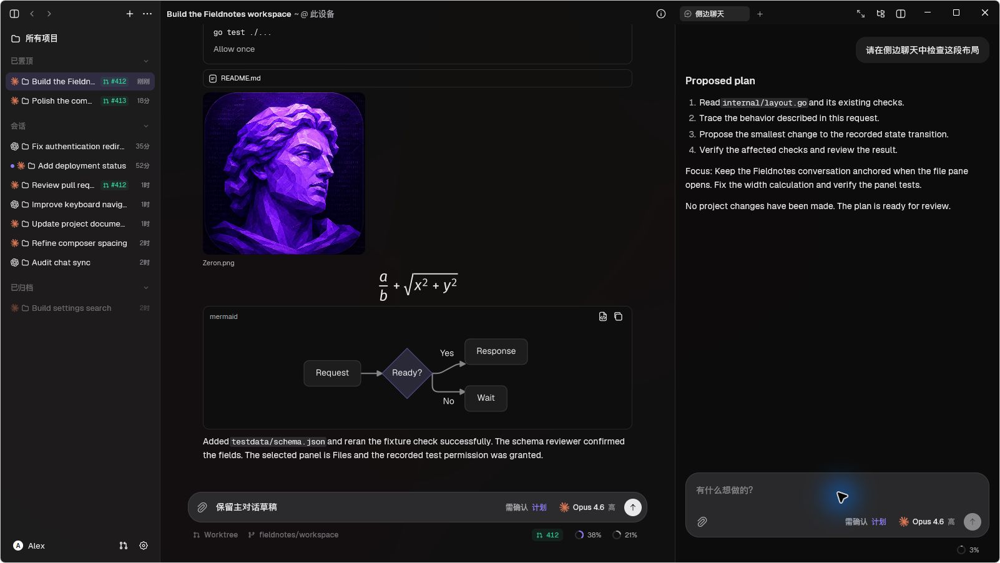

# GCode

**原生 Go 桌面编码智能体** · 同进程业务核心 · 可跑在无桌面的 Linux 主机上

[](https://go.dev)
[](https://github.com/egoist/mygo)
[](https://github.com/chengliang4810/GCode/releases)
[](https://github.com/chengliang4810/GCode/releases/latest)
[](THIRD_PARTY_NOTICES.md)

---

## 目录

- [这是什么](#这是什么)
- [特性](#特性)
- [截图](#截图)
- [安装](#安装)
- [快速开始](#快速开始)
- [从源码构建](#从源码构建)
- [命令行选项](#命令行选项)
- [项目结构](#项目结构)
- [文档](#文档)
- [已知限制](#已知限制)
- [贡献](#贡献)
- [许可与致谢](#许可与致谢)

## 这是什么

GCode 是一个用 Go + [MyGo](https://github.com/egoist/mygo) 实现的原生桌面编码智能体。

界面与业务核心在**同一个进程**内通过强类型 Go 接口、结构体和事件交互，不绕行 HTTP、WebSocket、JSON-RPC、stdio 或 JavaScript bridge。只有「浏览器面板」里外部网页的正文才交给系统 WebView 渲染。

同一套核心有两种运行形态：

| 形态 | 入口 | 说明 |
| --- | --- | --- |
| 桌面端 | `GCode`（源码 `cmd/rcode`） | 原生窗口 + 完整 UI |
| 无桌面服务 | `cmd/gcode-server` | 认证的 HTTP/SSE 服务，依赖图里不含 MyGo 与任何图形/窗口包，可部署在无显示器的 Linux 主机 |

桌面端可以连到远程服务；会话、任务、工作目录、工具进程和持久化都归**宿主**，客户端断开不会打断已接受的任务。

> 项目处于 `beta` 阶段：迭代很快，默认走正式更新通道。

## 特性

### 模型与对话

- 三种协议：**OpenAI Chat Completions**、**OpenAI Responses**、**Anthropic Messages**。协议与品牌解耦，供应商名称、Base URL、凭据、模型全部由你配置，不内置任何供应商目录。
- 流式回复、工具调用、思考内容、多会话与侧边对话。
- 输入框内联命令：`/init`（调查工作区并生成 AGENTS.md）、`/goal`（目标生命周期）、`/compact`（上下文压缩）。
- 上下文记忆边界、缓存诊断、Token 用量统计与近 30 天趋势。

### 工具与扩展

- 原生工具集：`Read`、`Bash`、`Edit`、`Write`、`Grep`、`Glob`、`ListDirectory`；文件编辑与预览、网页元素标注、PDF / HTML 内置预览。
- **MCP 服务器**、**技能（Skill）**、**用户命令**、**插件**、**钩子（Hook）**，新增与编辑一律走模态弹窗，保留列表上下文。
- **只读子代理**：受限工具集，不能改文件。
- **Git 能力**：会话绑定真实仓库工作树，支持历史搜索、刷新、提交详情与远程宿主读取。
- **原生工作流**：脚本检查 → 运行确认 → 执行进度 → 问题作答 → 留白补全 → 产物与运行目录。

### 自动化与桌面体验

- **自动化任务**：Cron、完成后间隔、手动执行、暂停与运行历史。
- **灵动岛**：任务进度、待输入、未读结果，悬停展开、移出收起。
- 菜单栏任务与用量面板，应用内通知，深浅主题，简中 / English 即时切换（**设置 → 通用 → 语言**，无需重启）。
- 命令面板（`/`、`@`、`$`）、快捷键、附件与文件引用原子化。

### 远程

- `cmd/gcode-server` 提供带认证的 HTTP/SSE 接口，支持 TLS、状态重建与事件续接。
- 非回环监听在没有 TLS 时拒绝启动，除非显式 `--allow-insecure-listen`；客户端只接受 HTTPS 远程地址。
- 凭据只经显式「揭示」动作返回，并记录审计日志。

## 截图

| 命令面板 | 供应商设置 | 会话侧栏 |
| --- | --- | --- |
|  |  |  |

截图取自原生桌面端（MyGo Tester 确定性数据），未做缩放或归一化处理。

## 安装

从 [Releases](https://github.com/chengliang4810/GCode/releases/latest) 下载对应平台的安装包：

| 平台 | 产物 | 说明 |
| --- | --- | --- |
| Windows 11 22H2+ (amd64) | `gcode-setup-<version>-x86.exe` | 安装包，双击安装 |
| macOS 13+ (Apple Silicon) | `gcode-<version>-arm64.dmg` | 拖入 Applications |
| macOS 13+ (Intel) | `gcode-<version>-x86.dmg` | 拖入 Applications |
| macOS 13+ (通用) | `gcode-<version>.dmg` | 同时支持两种架构 |
| Linux | 自行构建 | 无桌面服务，见下文 |

每个平台还附带签名归档 `gcode-<version>-<platform>.tar.gz`（`windows-amd64` / `darwin-amd64` / `darwin-arm64` / `darwin-universal`）与 `update-<platform>.json` 更新清单。

Linux 目前没有官方归档，需要无桌面服务时自行构建：

```bash
go build -o gcode-server ./cmd/gcode-server
```

应用内也可检查更新：**设置 → 关于 → 软件更新**。更新走 MyGo 原生更新器 + 签名校验过的 GitHub Releases。

## 快速开始

1. 安装并启动 GCode。
2. 打开 **设置 → 模型设置**，添加供应商：填写名称、协议、Base URL、凭据与模型名。
3. 新建对话，直接输入需求即可。

默认数据目录是 `~/.gcode`，可在 **设置 → 通用 → 数据保存目录** 更改（重启后生效，不搬迁旧数据）。

连接远程宿主：**设置 → Devices**，或用 `--connect` 搭配 `--token-file` 启动。

## 从源码构建

需要 **Go 1.27.3**。MyGo v0.10.0 以本地补丁形式内置在 `third_party/mygo`，`scripts/check-framework.go` 会校验源码身份与补丁哈希。

```bash
make run      # 构建并启动桌面端（产物名为 GCode）
make test     # go test ./...
make vet      # go vet ./... && go tool mygo vet .
make build    # go tool mygo build
make e2e      # 原生桌面端到端测试
```

不用 Make 时：

```bash
go build -o GCode ./cmd/rcode && ./GCode          # macOS / Linux
go build -o GCode.exe ./cmd/rcode && GCode.exe    # Windows
```

无桌面服务：

```bash
go run ./cmd/gcode-server --help
```

### 命令行选项

桌面端（`cmd/rcode`）：

| 选项 | 作用 |
| --- | --- |
| `--connect <url>` | 连接 GCode 无桌面主机（HTTP(S) 地址） |
| `--token-file <path>` | 从文件读取远程主机 API 令牌，与 `--connect` 搭配 |
| `--local` | 使用本机 Go 引擎，忽略已保存的远程连接 |
| `--language zh-CN\|en` | 覆盖已保存的界面语言 |
| `--appearance light\|dark\|system` | 覆盖外观（浅色 / 深色 / 跟随系统） |
| `--theme <variant>` | 选择内置主题变体 ID |
| `--dump-scene` | 写出初始的版本化界面契约 fixture（JSON）后退出 |
| `--headless` | 用 MyGo Tester 无窗口渲染，仅用于 UI 测试 |
| `--scenario <name>` | 使用隔离的确定性 mock 场景 |

无桌面服务（`cmd/gcode-server`）：

| 选项 | 作用 |
| --- | --- |
| `--listen <addr>` | 监听地址，默认 `127.0.0.1:27655` |
| `--tls-cert` / `--tls-key` | TLS 证书与私钥（配合安全隧道或反向代理） |
| `--allow-insecure-listen` | 允许无 TLS 的非回环监听 |
| `--data-dir <path>` | 指定配置/状态目录，默认 `~/.gcode` |
| `--show-token` | 打印本地远程 API 令牌后退出 |

`--scenario` 始终使用隔离的确定性 mock，`--data-dir` 只选择显式的 profile/状态目录。

## 项目结构

```
cmd/rcode           桌面端入口
cmd/gcode-server    无桌面远程服务入口
internal/desktop    MyGo 原生界面
internal/engine     Agent 执行引擎与系统提示词
internal/contracts  核心与 UI 之间的强类型契约
internal/model      三种模型协议适配
internal/mcp        MCP 服务器集成
internal/plugins    插件、技能与钩子
internal/remote     远程协议适配
internal/i18n       简中 / English 文案
docs/               设计与验收文档
third_party/mygo    带本地补丁的 MyGo
```

## 文档

| 文档 | 内容 |
| --- | --- |
| [系统提示词](docs/system-prompt.md) | 基础提示词正文、工具集与运行时追加规则 |
| [模型适配](docs/model-adapters.md) | 三种协议的请求与流式解析 |
| [上下文与记忆](docs/context-memory.md) | 记忆边界、压缩策略与缓存诊断 |
| [目标执行](docs/goals.md) | `/goal` 生命周期与完成检查 |
| [钩子](docs/hooks.md) | Hook 配置、异步执行与记录 |
| [插件](docs/plugins.md) | 插件格式、来源与运行范围 |
| [自动化与灵动岛](docs/automations-and-island.md) | 任务调度与桌面呈现 |
| [菜单栏与用量](docs/menubar-tasks-and-usage.md) | 任务面板与 Token 统计 |
| [远程服务](docs/backend-v1.md) | HTTP/SSE 协议、TLS、任务归属与限制 |
| [界面契约](docs/contracts.md) | UI 与核心之间的类型边界 |
| [桌面测试](docs/desktop-testing.md) | 原生 E2E 工作流与证据规范 |
| [更新与发布](docs/updates.md) | 签名、构建与发布流程 |
| [命名与归属](docs/branding.md) | GCode / rcode / 上游来源的命名约定 |
| [换机恢复](docs/machine-handoff.md) | 迁移到另一台机器的步骤 |

## 已知限制

- UI 视觉一致性优化自 2026-10-29 起暂停，**全量视觉对齐尚未验收**；当前 UI 即为原生后端的基线。
- 远程协议是外围适配层，业务执行逻辑始终在宿主侧。

## 贡献

```bash
git clone https://github.com/chengliang4810/GCode.git
cd GCode
make test && make vet
```

UI 改动请一并跑 `make e2e`（需要图形会话，插件只进入 `e2e` 构建），并遵守 [共享控件规范](docs/ui-controls.md) 与 [AGENTS.md](AGENTS.md)。

问题与建议请开 [Issue](https://github.com/chengliang4810/GCode/issues)；提交代码前请先看 `AGENTS.md` 的工作边界与验证要求。

## 许可与致谢

- 上游框架：[MyGo](https://github.com/egoist/mygo)，本仓库使用带本地补丁的副本，补丁见 `third_party/`。
- 上游参考实现与历史验收证据保留 Zeron 名称。
- 第三方依赖与许可证见 [THIRD_PARTY_NOTICES.md](THIRD_PARTY_NOTICES.md)。
- 本仓库暂未附带独立 LICENSE 文件，发布前需补充。
