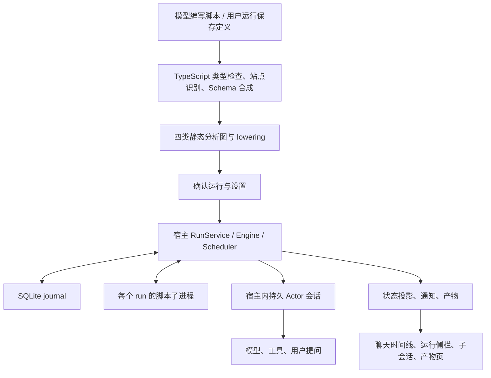

**ZCode workflow 实现与 GCode 承接能力调查**

调查日期：2026-10-30。本文是源码调查和实现建议，不是功能完成声明。

后续已按用户要求拉取 ZCode `3.17.1 / a60ba6a7`，并验证 moejs + JSON 路线。当前范围与结论以 [最新复核](D:/projects/GCode/docs/investigations/dynamic-workflow-moejs-json-2026-10-30.md) 为准；本页保留 `3.16.2 / 3c5b2276` 的历史调查，尤其 Actor 直接 AskUserQuestion 等行为已经变化。

结论：GCode 的 Go 业务核心和原生 MyGo UI 足以承接对应的工作流产品能力，但当前没有工作流引擎及其界面。若“完全实现”还要求原样运行 ZCode 的 `.dwf.ts`，保留 TypeScript 类型推导、静态分析、动态补全和重放语义，则需要额外建设语言工具链。现有普通子 Agent 加一个 DAG 面板不构成完整实现。

**调查基线与验证边界**

- 参考：`D:/projects/ZCode`，版本 `3.16.2`，提交 `3c5b227649371507ddc4eb46ac5133afe6db1cab`，工作区干净。
- ZCode freshness 检查未通过：当前 `main` 比 `origin/main` 落后一个提交。检查脚本默认执行 `git fetch origin --prune` 更新远端引用；本次没有合并或改动参考工作区，所有结论针对上述检出版本。
- 目标：`D:/projects/GCode`，HEAD `e864970`。目标工作区存在大量未提交和未跟踪实现，判断依据包含这些实际源码，不能仅用 HEAD 描述当前能力。
- 本次只新增调查报告，没有调整业务代码、依赖、用户配置，也没有恢复已暂停的视觉一致性目标。
- ZCode 根目录及 CLI 缺少 `node_modules`，没有安装依赖，没有执行其 TS 测试或启动实窗。本报告的 UI 结论是源码确认的布局与交互，不是截图或视觉验收。
- 已运行 GCode 相关核心与远程测试，结果见文末；没有调用真实供应商。

以下源码链接使用本机绝对路径。标明“风险”“建议”的内容属于分析判断，不冒充运行时测量。

**同名 workflow 必须分成三套看**

| 实现 | 当前用途 | 实际入口 |
| --- | --- | --- |
| Dynamic Workflow | 当前主要产品形态：模型编写 TypeScript，多 Actor 执行，带分析图、journal、恢复、修订、留白、产物 | `CreateWorkflow`、`/workflow`、保存工作流的直接运行 |
| Script Workflow | 旧 `.workflow.js` 执行体系，带脚本 metadata、预算和活动日志 | `Workflow` 工具 |
| Expert Workflow | 固定阶段及 DAG 执行体系 | CLI `/expert` |

证据：[动态工作流说明](D:/projects/ZCode/docs/dynamic-workflow.md:9)、[旧脚本工具](D:/projects/ZCode/apps/zcode-cli/packages/core/src/tool/handlers/workflow.ts:20)、[Expert 命令](D:/projects/ZCode/apps/zcode-cli/packages/cli/src/command-center/handlers/expert.ts:80)。

Expert 内置八阶段 `clarify → task_analysis → arch_decompose → env_setup → meta_prompt → exec → final_critic → complete`，有真实 ready/frontier 调度和文件 snapshot/JSONL 存储。但它不等于新版动态工作流模板库，也不证明旧 GUI Debugger 还存在。

证据：[Expert 定义](D:/projects/ZCode/apps/zcode-cli/packages/core/src/workflow/definition.ts:31)、[旧 DAG 调度](D:/projects/ZCode/apps/zcode-cli/packages/core/src/workflow/scheduler.ts:51)、[旧工作流存储](D:/projects/ZCode/apps/zcode-cli/packages/adapters/src/workflow/index.ts:35)。

**新版本质：执行程序，展示分析投影**

模型写的是普通 TypeScript 控制流：`await`、`Promise.all`、循环、条件、异常和辅助函数。引擎并非依次执行 UI 上的节点；UI 图是脚本分析后产生的展示投影，实际控制流由脚本运行。



关键分工：

- 编译器建立真实 TypeScript Program，不只是去掉类型注解。
- 分析器生成 site/data、causality、control-flow、handoff 四类图。
- lowering 给 facade 调用注入稳定站点身份，运行实例还带 ordinal。
- 每个 run 的脚本运行在 Node 子进程的 `vm` realm；通过受控调用向宿主请求能力。
- 每个 Actor 是宿主内独立、可持续多次 ask 的 AgentRuntime 会话，保持身份和历史；不是每 Actor 一个 OS 进程。
- Engine/Scheduler/Journal 拥有运行状态；脚本、普通 Agent 和 UI 不能各保存一套相互竞争的调度事实。

证据：[分析入口](D:/projects/ZCode/apps/zcode-cli/packages/dynamic-workflow/src/analysis/analyze.ts:73)、[统一编译](D:/projects/ZCode/apps/zcode-cli/packages/bootstrap/src/app/dynamic-workflow-run-compile.ts:36)、[启动装配](D:/projects/ZCode/apps/zcode-cli/packages/bootstrap/src/app/dynamic-workflow-run-launch.ts:159)、[脚本进程](D:/projects/ZCode/apps/zcode-cli/packages/dynamic-workflow-runtime/src/harness.ts:209)、[Actor driver](D:/projects/ZCode/apps/zcode-cli/packages/bootstrap/src/app/workflow-driver.ts:210)。

**DSL 和运行能力**

| 能力 | 当前语义 | 移植时不能省掉的部分 |
| --- | --- | --- |
| `agent()` / `.ask<T>()` | 同一 Actor 保持上下文，同 Actor 的 ask 按 FIFO；不同 Actor 可并行 | 可续接 Actor 生命周期，不能直接复用一次性只读子会话 |
| typed answer | 从 T 合成 JSON Schema，经 `submit_result` 校验结构化答案；无 T 时可用最终文本 | 类型/Schema 校验与有限修复，不能靠解析聊天文字替代 |
| 普通 TS 控制流 | 动态扇出、循环、分支、异常 | 静态 DAG 不能直接表达全部语义 |
| `files.*` / `git.*` | journal 化的宿主工作区读取 | 路径归属、输出上限、稳定结果和错误 |
| `world.run` | 宿主执行 argv 命令；命令名要求编译期字面量，参数可动态生成 | 副作用、超时、取消及恢复政策 |
| `phase()` | 展示分组与阶段标记 | 是显示语义，当前实现允许无 marker |
| `report()` / `artifact.*` | 流式报告与用户面产物，含 file、markdown、chart、table、metrics、board | 顺序、版本、幂等、断线读取与实际内容存储 |
| `channel<T>()` / `future()` | 并行流水线；channel 当前为无界 FIFO | 不能误称已有背压，需处理停滞与资源增长 |
| `hole<T>()` / Fill | 运行中补入函数体，在原词法环境执行；其他分支可继续 | 重分析、旧站点稳定、原子更新脚本/Schema/阶段与唤醒 |
| escalate / Resolve | Actor 向主 Agent 提问后等待 | 与直接向用户的 AskUserQuestion 是两种交互 |

证据：[Facade 与作者能力](D:/projects/ZCode/docs/dynamic-workflow/authoring.md:64)、[流式 channel](D:/projects/ZCode/apps/zcode-cli/packages/dynamic-workflow/src/facade/dts-stream.ts:17)、[词法 hole](D:/projects/ZCode/apps/zcode-cli/packages/dynamic-workflow/src/facade/dts-hole.ts:24)、[Fill 服务](D:/projects/ZCode/apps/zcode-cli/packages/bootstrap/src/app/dynamic-workflow-run-fill.ts:63)。

没有找到新版动态工作流的固定内置模板库。现有的是作者 skill、测试/示例，以及另一路 Expert 内置定义。保存的动态工作流位于项目 `.zcode/workflows/` 或全局 `~/.zcode/workflows/`，扩展名 `.dwf.ts`；默认解析中项目同名定义遮蔽全局定义。

证据：[保存定义解析与目录](D:/projects/ZCode/apps/zcode-cli/packages/core/src/tool/handlers/saved-workflows/store.ts:48)。

**UI 的实际形态与用户路径**

当前主界面不是 n8n 式自由拖拽节点编辑器。核心视觉是“阶段站点 + 子 Agent 药丸 + 轨道/弧线”，横向用于聊天与确认，纵向用于详情。

| 展示位置 | 用户看到什么 | 操作与信息 |
| --- | --- | --- |
| 模型正在写工具参数时 | 逐步出现的阶段线 | 草稿扫描，不等于已经执行 |
| 运行确认窗 | 名称、模型、并发上限、阶段时间线、折叠脚本；保存来源还有作用域与实参 | 允许一次、本会话允许、拒绝、附反馈要求修改；支持批准前调整设置 |
| 聊天轮尾运行卡 | 实时阶段灯、Actor 状态、并行轨道、循环/跳段弧、等待问题、产物 | 展开/收起、停止、可恢复时恢复、打开具体阶段或 Actor |
| 运行详情侧栏 | 纵向阶段脊柱、Actor 列表、待回答问题、使用量、并发/冷却、结果或错误、产物 | 打开真实 Actor transcript、脚本步骤、产物；设置调整及修订关系跳转 |
| 项目侧栏 | 会话下的工作流运行摘要行 | 跟踪后台活动并打开对应运行 |
| 完成卡 | 产物瓦片及四项统计 | 耗时、Token、子 Agent 数、进入阶段数；未知值显示 `—` |
| 自动化页中的工作流页 | 项目/全局分组、工作流卡片、参数摘要、最近状态、详情与运行历史 | 运行、修改元信息、复制路径、删除、作用域移动/提升 |
| 工作流运行窗 | 实参表单，必要时选择运行项目 | string/number/boolean/json 校验、必填/默认值、错误定位 |
| 产物侧栏 | 文件、Markdown、图表、表格、指标、看板等 | 文档/文件复用既有查看器，预置产物走专用渲染 |

直接证据：

- [确认块](D:/projects/ZCode/packages/ui/src/WorkflowPermissionBlock.tsx:111) 与 [权限按钮及反馈](D:/projects/ZCode/packages/ui/src/PermissionDialog.tsx:871)。
- [时间线组件](D:/projects/ZCode/packages/ui/src/components/workflow-timeline/WorkflowTimeline.tsx:59) 与 [统一模型](D:/projects/ZCode/packages/ui/src/components/workflow-timeline/timeline-model.ts:204)。
- [实时运行卡](D:/projects/ZCode/packages/ui/src/components/workflow-timeline/WorkflowRunDigest.tsx:82)。
- [运行侧栏](D:/projects/ZCode/packages/ui/src/app-shell/WorkflowRunSidePane.tsx:342) 与 [状态控制](D:/projects/ZCode/packages/ui/src/app-shell/WorkflowRunSidePaneSections.tsx:76)。
- [侧栏运行行](D:/projects/ZCode/packages/ui/src/components/workflow-run-line/TaskWorkflowRunLines.tsx:134)。
- [完成统计](D:/projects/ZCode/packages/ui/src/components/workflow-timeline/WorkflowCompletionCard.tsx:231)。
- [工作流页](D:/projects/ZCode/packages/ui/src/settings/saved-workflows/SavedWorkflowsSection.tsx:84)、[卡片](D:/projects/ZCode/packages/ui/src/settings/saved-workflows/SavedWorkflowCard.tsx:113)、[详情](D:/projects/ZCode/packages/ui/src/settings/saved-workflows/SavedWorkflowDetailView.tsx:257)、[启动表单](D:/projects/ZCode/packages/ui/src/settings/saved-workflows/SavedWorkflowLaunchDialog.tsx:98)。
- [产物分派](D:/projects/ZCode/packages/ui/src/app-shell/workflow-artifacts/WorkflowArtifactBody.tsx:27)、[图表/表格/指标/看板类型](D:/projects/ZCode/packages/ui/src/app-shell/workflow-artifacts/presets/spec.ts:27)。

直接运行已保存工作流的链路是：创建空会话 → 发 `startSavedWorkflow` → accepted 后导航。不是先让模型重新解释一遍“请运行”；失败会尝试回收空会话并把错误留在当前界面。全局定义运行目标使用本地项目候选；不能推定全局定义可以任意直接在远端项目运行。

证据：[直接启动器](D:/projects/ZCode/packages/ui/src/settings/saved-workflows/useSavedWorkflowLauncher.ts:160)、[全局本地项目候选](D:/projects/ZCode/packages/ui/src/settings/saved-workflows/SavedWorkflowsSection.tsx:110)。

**展示图不是引擎全量真相**

前端只消费有界 display 和运行投影，不拿完整分析器内部对象。当前 display 上限包括 64 个 step、32 个 lane、64 个 participant、32 个 phase、128 条 phase edge、32 个 hole。超界会截断或整体移除阶段词汇并标记 truncated；这些是显示边界，不是“引擎最多运行 64 个节点”。

证据：[图上限](D:/projects/ZCode/apps/zcode-cli/packages/contracts/src/tools/create-workflow.ts:223)、[有界图构建](D:/projects/ZCode/apps/zcode-cli/packages/core/src/tool/handlers/create-workflow-graph-bounds.ts:61)。

`buildWorkflowTimeline(graph, run)` 是统一纯模型入口，静态图和实际节点实例合成展示；确认窗没有运行状态，运行卡与侧栏叠加真实状态。源码以 DOM 为主体、SVG 画弧，没有引入一个自由节点画布库。

几何源值是站宽 168、站间距 24、药丸高 32、药丸间距 6；这些说明 ZCode 的构图，不是授权 GCode 业务页覆盖共享控件尺寸。GCode 应保留自己的 `design/controls.go`、`settings_controls.go` 和设置页共享外框。

证据：[时间线几何](D:/projects/ZCode/packages/ui/src/components/workflow-timeline/timeline-geometry.ts:9)、[GCode 控件规范](D:/projects/GCode/docs/ui-controls.md:1)。

参考实现自身也有表达损失：静态分析不能解析的 await 会使并行关系变宽，图可能退成直线；没有 phase-left 事件，某些分支形态会让多个阶段同时亮；部分轮数来自实例 ordinal。不能把这套图承诺成所有任意 TS 程序的精确时序证明。

证据：[参考实现已列明的展示限制](D:/projects/ZCode/docs/dynamic-workflow/presentation.md:2200)。

**运行可靠性与成本边界**

并发有三层：同 Actor FIFO、每 run ask 上界、进程内共享模型请求 governor。默认 run 并发是 `max(4, min(16, availableParallelism()-2))`；用户上界至少为 1，没有固定最高值。共享 governor 按 provider/model 分桶，并非整个账户或跨机器的统一配额控制。

证据：[默认并发和归一化](D:/projects/ZCode/apps/zcode-cli/packages/bootstrap/src/app/workflow-default-concurrency.ts:31)、[共享 governor](D:/projects/ZCode/apps/zcode-cli/packages/bootstrap/src/app/workflow-concurrency-governor.ts:1)。

模型按 persona 指定、run 指定、journal pin、父会话模型的顺序解析；pin 不可用时明确失败。Actor 继承创建 run 时的权限模式，之后切换父会话模式不会修改该 run。参考代码对于旧记录/未知模式回落 YOLO 的兼容行为，不应默认带进 GCode：本项目明确不默认做旧数据兼容。

Actor 并非天然只读 reviewer。工具集会移除越权编排与 plan 类工具，其他工作工具仍存在；共享相同目录，没有自动每 Actor worktree 或写文件互斥。

证据：[模型策略](D:/projects/ZCode/apps/zcode-cli/packages/bootstrap/src/app/workflow-actor-model.ts:7)、[权限模式](D:/projects/ZCode/apps/zcode-cli/packages/bootstrap/src/app/workflow-actor-permission.ts:5)、[Actor 工具集](D:/projects/ZCode/apps/zcode-cli/packages/bootstrap/src/app/workflow-actor-tools.ts:12)。

SQLite 使用 `dwf_run`、`dwf_actor`、`dwf_node`、`dwf_event`。恢复不仅取缓存结果，还按历史 settle 顺序释放并发续体，防止后续实例身份漂移。原 run 的 resume 要求字节一致的有效脚本；目前仅 stopped 且未被替代的 run 可 resume。completed/errored 不能按相同入口直接恢复。

amend 会预检、停止活动前驱、等待结算和转录静默，再启动有 lineage 的新 run。导入缓存有前缀/分歧规则，不能按名字把所有旧答案无条件复用。单纯并发设置调整可以就地 retune，不应一概说所有调整都新建 run。

证据：[SQLite 表](D:/projects/ZCode/apps/zcode-cli/packages/adapters/src/storage/session-store/migrations.ts:865)、[恢复顺序](D:/projects/ZCode/apps/zcode-cli/packages/dynamic-workflow/src/engine/engine-resume.ts:20)、[可恢复判断](D:/projects/ZCode/apps/zcode-cli/packages/bootstrap/src/app/dynamic-workflow-run-observation.ts:620)、[修订过程](D:/projects/ZCode/apps/zcode-cli/packages/bootstrap/src/app/dynamic-workflow-run-submit.ts:107)、[导入缓存](D:/projects/ZCode/apps/zcode-cli/packages/dynamic-workflow/src/engine/imported-cache.ts:26)、[并发就地调整](D:/projects/ZCode/apps/zcode-cli/packages/bootstrap/src/app/dynamic-workflow-run-retune.ts:32)。

两项不能照着宣传的风险：

1. **Journal 不保证副作用 exactly-once。** world 命令先写 running，再执行 I/O，最后记录 completed；running 在 resume 时重执行。因此命令已产生副作用但结果尚未记账就崩溃，可能重复执行。Actor 已修改文件但尚未提交答案也有类似窗口。
2. **取消链路有待单独回归。** 可以确认 run 会停止脚本/Actor，但当前 `world.run → executionPort.run` 调用没有传递 run abort signal。现有证据不足以证明宿主外部命令同步被取消；这不等于已实测发现孤儿进程。

证据：[running 重放与完成记账](D:/projects/ZCode/apps/zcode-cli/packages/dynamic-workflow/src/engine/engine-world.ts:69)、[宿主命令调用](D:/projects/ZCode/apps/zcode-cli/packages/bootstrap/src/app/workflow-world-read.ts:311)、[driver world 调用](D:/projects/ZCode/apps/zcode-cli/packages/bootstrap/src/app/workflow-driver.ts:459)。

此外，脚本 vm 暴露受控 host 能力、不提供 process/require/fetch 等，并不意味着整个工作流只读或拥有 OS 级隔离。`world.run` 本就可执行命令。app 关闭会停止 run；journal 使其可恢复，不会使工作流脱离宿主独立存活。

**GCode 当前能力对照**

| 范围 | 当前实际状态 | 完整承接还需要什么 |
| --- | --- | --- |
| 模型与工具 | 真实三协议模型、工具循环、流式事件 | Workflow 结构化结果约束、节点执行接口 |
| 子 Agent | 独立会话/历史/配置；后台完成可唤醒父会话；最多 8 个 | 可多次 ask 的持久 Actor、Actor FIFO、运行级所有权 |
| Goal | 暂停/恢复、预算、完成检查和继续执行 | 不能替代确定性分支/循环/依赖调度 |
| Workflow 实体 | 缺失 | Definition、Run、Actor、Site/Instance、事件、产物与持久等待 |
| 调度 | 缺失 | 动态扇出、分支、循环、汇合、错误传播、流式 channel/future |
| 运行中修改 | 缺失 | retune/amend/fill、版本与 lineage、旧结果可复用判定 |
| 存储 | engine.json 原子写入，能保留会话/历史 | 节点 journal、顺序恢复、产物数据、未知副作用策略 |
| 宿主重启 | running 标为 interrupted，goal paused | 不自动重跑；需明确新增的恢复策略和显式恢复入口 |
| 用户交互 | 真实 ask_user 等待；hooks 有 allow/deny | 持久化 workflow 批准/问题等待及来源、归属 |
| 远程 | 认证、任务脱离客户端继续、重连完整 snapshot | 工作流投影、历史查询、持久事件续接与产物读取 |
| 移动客户端 | 尚无 Android/iOS 客户端 | 不应将 HTTP 接口存在等同移动端完成 |
| 原生 UI | 会话、子 Agent 摘要/侧栏、Goal 与共享设置控件 | 全部 workflow 列表、确认、时间线、详情、产物与操作 |

关键证据：[Agent 核心](D:/projects/GCode/internal/agent/agent.go:24)、[子 Agent](D:/projects/GCode/internal/engine/subagents.go:149)、[子会话只读限制](D:/projects/GCode/internal/engine/run.go:59)、[Goal](D:/projects/GCode/internal/engine/goal.go:324)、[重启策略](D:/projects/GCode/internal/engine/engine.go:138)、[持久化](D:/projects/GCode/internal/engine/engine.go:303)、[远程重连](D:/projects/GCode/internal/remote/client.go:171)、[当前明确范围](D:/projects/GCode/docs/backend-v1.md:200)。

GCode 的本机 UI 已直接调用 Go Service 并通过 `Window.Update` 接收事件；headless 复用同一核心。这正适合增加核心所有的 workflow，不需要将本机界面改成 HTTP/stdio 客户端。

证据：[桌面核心注入](D:/projects/GCode/cmd/rcode/main.go:106)、[UI Service 事件](D:/projects/GCode/internal/desktop/app.go:228)、[无桌面入口](D:/projects/GCode/cmd/gcode-server/main.go:63)。

MyGo 已具备路径、贝塞尔连线、绘制变换、滚动/缩放与输入处理，因此原生时间线、纵向脊柱和可点击 Actor 没有必须使用 WebView 的障碍。但库没有现成工作流组件，需要实现布局、裁剪、命中、键盘导航、无障碍与状态投影；“有 Painter”不等于已完成 UI。

证据：[Path](D:/projects/GCode/third_party/mygo/ui/path.go:48)、[StrokePath](D:/projects/GCode/third_party/mygo/ui/path.go:587)、[绘制变换](D:/projects/GCode/third_party/mygo/ui/paint.go:1304)、[滚动/缩放与输入](D:/projects/GCode/third_party/mygo/ui/handler.go:39)。

**“完全实现”的可行性判断**

| 目标口径 | 判断 |
| --- | --- |
| 相同的原生列表、时间线、确认和详情体验 | 可实现，需要独立 UI 和模型层；当前未实现或视觉验收 |
| 对应的多 Actor、动态编排、恢复、修改和产物业务能力 | 可在 Go 核心实现，需要新增完整子系统 |
| 改为固定节点静态 DAG，然后声称完整对等 | 不成立，会丢失动态脚本和恢复语义 |
| 原样运行 `.dwf.ts`，包括 ask 泛型、抽象分析和词法 hole | 当前基础不足，必须单列编译器/解释器工程 |
| 纯 Go 且不增加语言运行时依赖，同时低成本原样支持任意 TS | 当前没有支撑该承诺的源码或验证证据 |

有两条可选路线，不能混淆交付范围：

- **Go 自有工作流表达与运行器。** Go 持有 IR/状态，逐步支持 actor、条件、循环、动态集合、流、留白和结构化结果。最符合当前实现；可达到对应业务体验，但不能声称兼容 ZCode TS 源文件。
- **保留 TypeScript 作者体验。** 增加受控语言工具链和执行层，Go 仍拥有 Actor、模型、工具、持久化与权限。隔离脚本进程属于真实执行边界，与“本机 UI 用协议绕行核心”不同；但其依赖、分发体积、进程生命周期、离线与 Windows/Linux 支持必须成为显式架构决定。仅 transpile TS 成 JS 不足以完成 schema、分析、lowering、hole 和 Promise 重放。

建议以完整能力清单锁定目标，分期交付；首期可用声明式表达，但从类型/实例/journal 层预留动态语义，不能把首期静态子集包装成全量完成。

建议实现顺序：

1. 先定义 WorkflowRun、Actor、Site/Instance、事件、终止与恢复规则；提取可持续 Actor 执行接口，接真实模型/工具。
2. 实现 journal、依赖与动态控制、FIFO/并发、结构化提交、停止/恢复、用户等待和副作用未知状态；建立故障注入测试。
3. 实现原生确认、聊天时间线、运行侧栏、Actor transcript、保存定义/参数/历史及产物闭环；所有设置使用共享入口。
4. 再补 amend/retune/fill、流式管道、全量语言作者能力及远程投影/续接；按能力逐项验收。

需要提前计入的成本：

- 现有 `Record`/持久化和广播以整份 state/snapshot 为主，多 Actor 高频流式会增加锁、复制和落盘压力。这是源码推导的风险，尚无基准测量。
- 并发写同一工作区会冲突；独立上下文不是文件隔离，需要显式工作分配或 worktree/合并策略。
- 多 Actor、重试和循环提高请求量；ZCode 新动态工作流本身没有等同旧 Script 的硬 Token 预算。GCode 已有 Goal 预算，可借鉴，但必须单独定义 workflow 预算的归属。
- 恢复操作必须区分“结果已知”“结果未知”“可幂等重试”，不能无条件重复 shell 或文件写入。
- 不能把用户自定义供应商设计改成参考项目的固定服务目录；模型绑定应复用 GCode 当前配置。
- 当前没有完成流程的前提下，不提供“几天完成”或精确百分比的无依据估计。语言兼容口径决定了最大的工程差异。

源码规模仅作范围提示：`dynamic-workflow/src` 为 120 个 TS 文件、24,551 行；其 `tests` 为 343 个 TS 文件、19,576 行；仅 `components/workflow-timeline` 就有 55 个 TS/TSX 文件、10,448 行。统计不含全部 bootstrap、存储、协议及其他 UI，也不等同必要移植代码量。

**发现的文档/注释与当前代码不一致**

1. `docs/workflow-debugger.md` 声称旧 `IWorkflowService`、`zcode.dev/workflow/*`、`workspace_workflow_event` 和恢复的 Workflows 页签仍在。当前 packages/CLI 搜索未找到这些符号；真实新链路是动态运行 Port 和 V4 workflowRuns。更早 Expert runtime 仍在，不能据旧 UI 文档推断它不存在。
2. `docs/dynamic-workflow.md:217–218` 写“run 内无 prompt”。实际 Actor 继承发起会话权限模式，必要时经父 broker 问用户；较新的 `launch.md:1064` 已正确描述这一点。
3. 同入口文档 `:193` 称唯一硬规则是 facade 必须直接调用。实际分析还检查 world.run 命令字面量、artifact、模型、phase、hole、重复 Actor 名等约束；见 `analysis/analyze.ts:95`。
4. 同入口文档 `:196–198` 称开跑前静态图已完整、运行只装饰。对含 hole 的流程需要限定：Fill 会加入新函数体并更新有效脚本、图、Schema 和阶段表；见 `dynamic-workflow-run-fill.ts:143`。
5. `analysis/world-run.ts:4–6` 注释称 driver 会复验提交时命令集合。实际 `workflow-world-read.ts:294–299` 明确删除了这份重复白名单，因为它无法同步动态 Fill。
6. facade 的 phase 文档 `dts.ts:178` 写 Required；实际 `analysis/phases.ts:27–30` 明说无 marker 合法，UI 也支持隐式阶段。不能据 Required 文案设计出与参考现状不同的强制规则。

这些偏差本次只记录，没有修改只读参考仓库。GCode 当前 `docs/subagents.md` 和 `docs/backend-v1.md` 对“工作流不在现有子 Agent 路径”“不是 Durable 工作流”的声明与本轮检查一致。

**验证与后续验收**

本轮运行：

```powershell
go test ./internal/engine ./internal/remote -run 'Test(Subagent|BackgroundSubagent|SynchronousSubagent|Goal|DisconnectDoesNotCancelHostTaskAndReconnectRestoresState|SubscriptionReportsDisconnectAndReconnectWithoutReplayingTasks|QuestionAnswerIsRecordedOnceBeforeContinuing|InterruptedReplyRetriesWithoutRepeatingCompletedTools)' -count=1
```

结果：`internal/engine` 通过（7.396s）；`internal/remote` 通过（1.204s）。这是本地协议夹具与真实 Go 核心回归，不是新增 workflow、真实供应商或原生窗口验收。

ZCode 有编译/图、Schema、Scheduler、Replay、Hole、Retune、vm、SQLite 和真实 AgentRuntime 装配测试；其中集成测试仍使用脚本模型/罐头模型等夹具。本轮没有运行，不能把测试存在写成已通过。

后续若实施，至少需要分别验收：确定性引擎与故障恢复、真实本地 Go 核心、MyGo Automation 原生交互、真实远程宿主及断线/重启、真实供应商限流/结构化提交、浅深主题/窄窗/键盘与大规模展示。每层证据独立记录。
